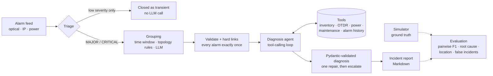

# noc-incident-agent


An LLM agent that turns a storm of telecom network alarms into a short list of diagnosed
incidents — *"fiber cut on CBL-002, ~4.5 km from site BEL, dispatch a crew"* — together with a
network simulator that produces realistic alarms **with ground truth**, so every design choice
can be measured instead of guessed.

It is a public, from-scratch re-implementation of the ideas behind an agent
for a NOC (Network Operations Center). Everything here is synthetic: the network, the sites and
the alarms are invented, and no operator code or data is included.

## The problem

A single cut cable does not raise one alarm. Both optical terminals lose light, the supervisory
channel drops, every IP link riding on the fiber goes down a minute later, and an OTDR
break-location result arrives 6–14 minutes after that. Meanwhile, unrelated faults happen at
other sites at the same time, and dozens of low-value alarms (temperature, fans, login failures,
flapping ports) keep scrolling past.

The NOC has to answer three questions quickly: **which alarms belong together, what is the root
cause, and where do we send people?**

## How it works



| Stage | What it does |
|---|---|
| `synth.py` | Builds a ring-and-chord backbone (optical spans in shared cables, IP links over spans, site power) and injects fiber cuts, power outages that drain batteries until the site goes dark, line-card failures, planned works and background noise. Records the ground truth. |
| `grouping.py` | Three strategies: a **time window** (how many NOC rules are written), **topology rules** (union alarms that share a span, cable, IP link, line card or site power within a time window) and **LLM grouping** with topology context in the prompt. |
| `agent.py` | A ReAct-style loop over the OpenAI tool-calling format. The prompt holds short runbooks; the model must collect evidence with tools before it concludes. |
| `tools.py` | Inventory lookups, OTDR traces, power status, maintenance windows and alarm history, answered from the simulator **as of the incident time**, so the agent cannot read the future. |
| `evaluate.py` | Scores grouping (pairwise precision/recall/F1, exact incident recovery) and diagnosis (root cause, location, OTDR distance error, false incidents raised from noise). |

## Quick start (offline, no GPU, no API key)

```bash
pip install -e ".[dev]"
noc-agent generate --seed 7 --out data/sample     # synthetic network + alarms + ground truth
noc-agent run --data data/sample --grouping topology --out runs/topology
noc-agent eval --seeds 20                          # benchmark the grouping strategies
pytest
```

`--llm mock` (the default) replaces the model with a deterministic policy that speaks the same
protocol — tool calls and JSON answers — and follows the runbooks step by step. It makes the
whole pipeline runnable in CI. Its scores are a **rule-based baseline, not a model result**.

A finished run is committed in [`examples/sample-run`](examples/sample-run): the
[summary](examples/sample-run/summary.md) and one report per incident, for example this
[fiber cut](examples/sample-run/incidents/G-007.md) with the tool calls that confirmed it.

## Results

Offline baseline, 20 synthetic 6-hour datasets (≈90 alarms and 7 incidents each):

| Grouping | Grouping F1 | Exact groups | Root cause | Location | False incidents | LLM calls |
|---|---:|---:|---:|---:|---:|---:|
| `time_window` | 0.69 | 12% | 62% | 61% | 0.1 | 30 |
| `topology` | 0.99 | 96% | 99% | 99% | 0.0 | 24 |
| `llm` (mock) | 0.99 | 96% | 99% | 99% | 0.0 | 26 |

The time window fails exactly where it matters: when a power outage at one site starts in the
same minute as a fiber cut elsewhere, both land in one group, and the diagnosis of that group
is wrong for at least one of them. On the sample dataset that drops root-cause accuracy from
100% to 43%. Grouping quality decides diagnosis quality.

### Benchmark a real model

Any OpenAI-compatible server works: vLLM, llama.cpp, Ollama, LM Studio or a hosted API.

```bash
# e.g. Ollama
export NOC_LLM_BASE_URL=http://localhost:11434/v1
export NOC_LLM_MODEL=qwen3:8b

# e.g. vLLM serving a Qwen3 model with thinking switched off
export NOC_LLM_BASE_URL=http://localhost:8000/v1
export NOC_LLM_MODEL=Qwen/Qwen3-8B
export NOC_LLM_EXTRA_BODY='{"chat_template_kwargs": {"enable_thinking": false}}'

noc-agent eval --seeds 10 --grouping topology,llm --llm openai --out runs/qwen3-8b
```

<!-- Add your own rows here, e.g. | qwen3:8b | ... | -->

## Design decisions

These come from running an agent like this against a real NOC, where a wrong page at 3 a.m.
costs more than a slow one.

- **Deterministic where possible, LLM where it adds value.** Triage closes groups that hold
  only low-severity alarms without calling a model, and keeps them out of the grouping prompt.
  That is most of the alarm volume.
- **Never trust free-form output.** The grouping reply is repaired so that every alarm appears
  exactly once (unknown ids dropped, duplicates removed, missing ones kept as singletons). If
  the reply is unusable, that chunk falls back to the topology rules. The diagnosis is
  validated with pydantic, gets one repair attempt, and otherwise escalates as `UNKNOWN` with
  confidence 0 — never a guess.
- **Hard links beat the model.** An alarm that names another alarm (an OTDR result pointing to
  the light-loss alarm it measured) always joins it, even across prompt chunks.
- **Tools cannot see the future.** Every tool answers as of the newest alarm in the incident,
  the way a live system would.
- **Tool errors are data.** A bad span id or malformed arguments come back to the model as an
  error message it can correct, instead of crashing the run.
- **Reasoning models need care.** `<think>` blocks are stripped, JSON is extracted from fenced
  or chatty replies, and thinking can be switched off per request (`NOC_LLM_EXTRA_BODY`)
  when it only adds latency.
- **Measure everything.** The simulator's ground truth turns "the agent seems good" into
  numbers, and makes regressions visible in CI.

## Project layout

```
src/noc_agent/
  models.py      data types (alarms, topology, hidden world state, ground truth, diagnosis)
  synth.py       network + fault simulator
  context.py     topology-enriched alarm records for prompts
  grouping.py    time-window, topology and LLM grouping
  tools.py       agent tools + OpenAI tool schemas
  agent.py       tool-calling diagnosis loop
  llm.py         OpenAI-compatible client (stdlib only), JSON extraction
  mock.py        deterministic offline stand-in for the model
  pipeline.py    triage -> grouping -> diagnosis
  evaluate.py    metrics against ground truth
  report.py      Markdown incident reports
  prompts/       grouping and diagnosis prompts
tests/           40 tests, including failure paths (bad JSON, bad tool args, step limits)
```

## Roadmap

- Benchmark open models (Qwen3, Gemma, Llama) and publish the table above for each.
- Streaming mode: process the feed in cycles and carry open incidents across them.
- Fine-tune a small model on traces generated by the simulator, and compare it with prompting.
- Expose the tools as an MCP server so any agent framework can use them.

## License

MIT. The network, sites and alarms are fictional; this project is not affiliated with any
operator or vendor.
